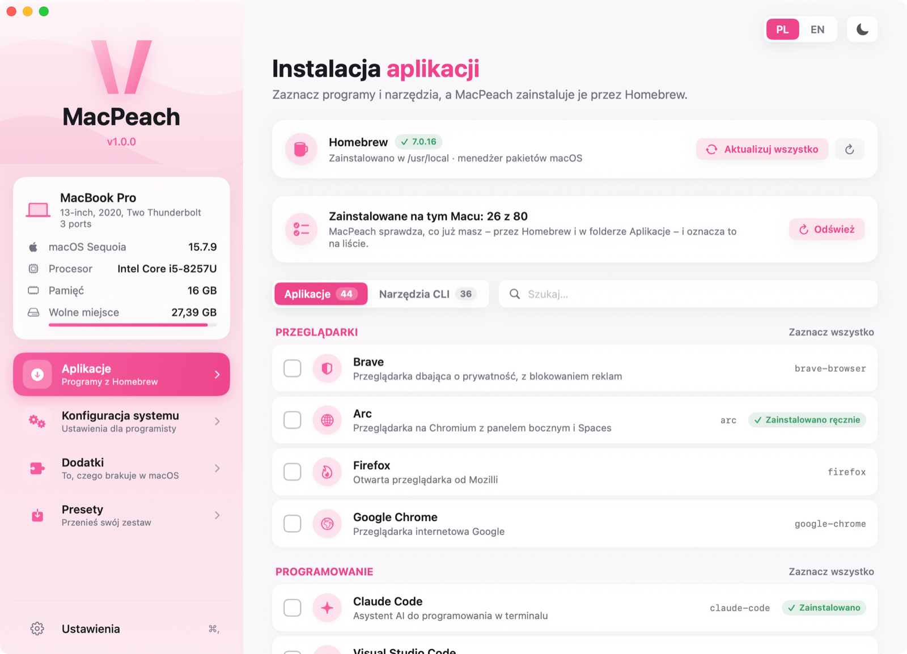
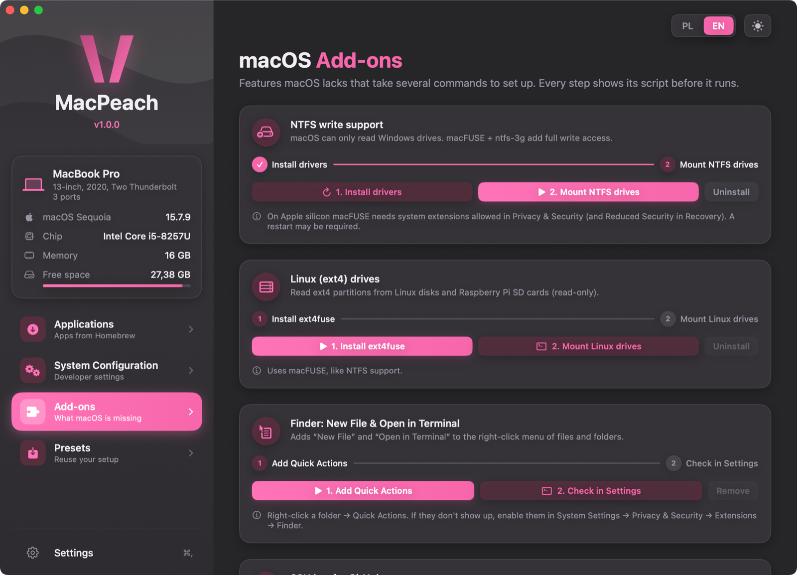

# MacPeach

[Wersja PL](#wersja-pl) | [Wersja ENG](#wersja-eng)

## Wersja PL

Aplikacja do konfiguracji nowego Maca w kilka minut. Instaluje programy i narzędzia przez Homebrew, ustawia macOS pod pracę programisty i dodaje funkcje, których w systemie brakuje. Każdy skrypt można obejrzeć przed uruchomieniem.

Napisana w SwiftUI, bez zewnętrznych bibliotek. Wymaga macOS 14 Sonoma lub nowszego.



### Funkcje

- **Aplikacje** – 44 programy (`brew install --cask`) i 36 narzędzi CLI w kategoriach, z wyszukiwarką. Przy starcie MacPeach sprawdza, co już jest na Macu (przez Homebrew lub zainstalowane ręcznie), i oznacza te pozycje zielonym „Zainstalowano”.
- **Konfiguracja systemu** – 61 ustawień: Finder, Dock, zrzuty ekranu (np. do schowka), klawiatura, gładzik, energia (czas uśpienia komputera i ekranu, osobno na zasilaczu i baterii), Git, zapora. MacPeach odczytuje bieżące wartości, oznacza ustawienia, które już obowiązują, i pokazuje obecne parametry obok listy wyboru.
- **Dodatki** – funkcje wymagające kilku poleceń: zapis na dyskach NTFS, odczyt dysków ext4, „Nowy plik” i „Otwórz w Terminalu” pod prawym przyciskiem w Finderze, klucz SSH do GitHuba, Touch ID dla `sudo`.
- **Presety** – zapis zaznaczeń do `~/.config/macpeach/presets.json`, eksport i import, żeby odtworzyć ten sam zestaw na innym Macu.
- Prawdziwe dane o urządzeniu (model, macOS, procesor, pamięć, wolne miejsce), odświeżane na bieżąco.
- Język polski i angielski, tryb jasny i ciemny.
- Logi w `~/Library/Logs/MacPeach`: wynik każdego skryptu, błędy, raport po awarii lub zawieszeniu pokazywany przy następnym uruchomieniu. Nic nie jest nigdzie wysyłane.

### Instalacja

Pobierz `MacPeach.dmg` z [Releases](https://github.com/PainPorsche/MacPeach/releases), otwórz go i przeciągnij **MacPeach** do folderu **Applications**. Wersja jest uniwersalna – działa na Macach z procesorem Intel i Apple silicon. Przy pierwszym uruchomieniu zobacz sekcję [Pierwsze uruchomienie pobranej aplikacji](#pierwsze-uruchomienie-pobranej-aplikacji).

Do wydania dołączony jest też `MacPeach_procedura_v1.0.0.pdf` – opis zmian w wersji 1.0.0 (PL i ENG).

### Lista pakietów

Pozycje są wczytywane z pliku [`MacSetup.sh`](MacPeach/MacSetup.sh), który jest też samodzielnym skryptem instalacyjnym. Komentarz `# English | Polski` nad poleceniem to jego opis w obu językach, a `# --- Kategoria ---` zaczyna nową sekcję. Ustawienie z listą wyboru opisują dwie dodatkowe linie: `# @options 0=Never|Nigdy; 5=5 min` oraz `# @current <polecenie odczytujące obecną wartość>`, a w poleceniu wartość wstawiana jest w miejsce `${VALUE:-domyślna}`. W **Ustawieniach** można utworzyć własną kopię w `~/.config/macpeach/MacSetup.sh` i edytować listę bez przebudowywania aplikacji.

### Budowanie

```
git clone https://github.com/PainPorsche/MacPeach.git
cd MacPeach
open MacPeach.xcodeproj
```

W Xcode wybierz schemat **MacPeach** i **Product > Run**. Z terminala:

```
xcodebuild -project MacPeach.xcodeproj -scheme MacPeach -configuration Release -destination 'generic/platform=macOS' build
```

### Procesory Intel i Apple silicon

Program jest rozwijany i testowany na MacBooku Pro (13-inch, 2020, Two Thunderbolt 3 ports) z procesorem Intel. Build Release jest uniwersalny (`x86_64` + `arm64`), więc działa natywnie na obu architekturach. Ścieżki Homebrew (`/usr/local` i `/opt/homebrew`) są wykrywane automatycznie.

### Pierwsze uruchomienie pobranej aplikacji

Aplikacja jest podpisana tylko lokalnie i nie przeszła notaryzacji Apple. Jeśli pobierzesz gotową aplikację (`MacPeach.dmg`) z internetu, macOS może zablokować pierwsze uruchomienie. Na Macach z procesorem Apple (M1 i nowsze) komunikat bywa mylący: „aplikacja jest uszkodzona i nie można jej otworzyć”. Aby ją uruchomić:

- otwórz **Ustawienia systemowe › Prywatność i ochrona** i kliknij **Otwórz mimo to**, albo
- usuń znacznik kwarantanny w Terminalu:

```
xattr -dr com.apple.quarantine /Applications/MacPeach.app
```

Ten problem nie dotyczy aplikacji zbudowanej samodzielnie w Xcode.

## Wersja ENG

An app that sets up a new Mac in minutes. It installs apps and tools with Homebrew, tunes macOS for development work and adds features the system lacks. Every script can be reviewed before it runs.

Built with SwiftUI and no third-party dependencies. Requires macOS 14 Sonoma or later.



### Features

- **Applications** – 44 apps (`brew install --cask`) and 36 CLI tools grouped into categories, with search. On launch MacPeach checks what is already on the Mac (via Homebrew or installed manually) and marks those items with a green “Installed”.
- **System Configuration** – 61 settings: Finder, Dock, screenshots (e.g. to the clipboard), keyboard, trackpad, energy (computer and display sleep time, separately on power adapter and battery), Git, firewall. MacPeach reads the current values, marks the settings already in effect and shows current parameters next to the choice list.
- **Add-ons** – features that take several commands: NTFS write support, ext4 read access, “New File” and “Open in Terminal” in the Finder right-click menu, an SSH key for GitHub, Touch ID for `sudo`.
- **Presets** – save selections to `~/.config/macpeach/presets.json`, export and import them to recreate the same setup on another Mac.
- Real device information (model, macOS, chip, memory, free space), refreshed live.
- Polish and English, light and dark mode.
- Logs in `~/Library/Logs/MacPeach`: the output of every script, errors, and crash or hang reports shown on next launch. Nothing is sent anywhere.

### Installation

Download `MacPeach.dmg` from [Releases](https://github.com/PainPorsche/MacPeach/releases), open it and drag **MacPeach** to the **Applications** folder. The build is universal – it runs on both Intel and Apple silicon Macs. For the first launch see [First launch of a downloaded app](#first-launch-of-a-downloaded-app).

The release also includes `MacPeach_procedura_v1.0.0.pdf` – a description of the changes in version 1.0.0 (PL and ENG).

### Package list

Items are read from [`MacSetup.sh`](MacPeach/MacSetup.sh), which is also a standalone setup script. A `# English | Polski` comment above a command is its description in both languages, and `# --- Category ---` starts a new section. A setting with a choice list has two extra lines: `# @options 0=Never|Nigdy; 5=5 min` and `# @current <command that reads the current value>`; the chosen value replaces `${VALUE:-default}` in the command. In **Settings** you can create your own copy at `~/.config/macpeach/MacSetup.sh` and edit the list without rebuilding the app.

### Building

```
git clone https://github.com/PainPorsche/MacPeach.git
cd MacPeach
open MacPeach.xcodeproj
```

In Xcode choose the **MacPeach** scheme and **Product > Run**. From the terminal:

```
xcodebuild -project MacPeach.xcodeproj -scheme MacPeach -configuration Release -destination 'generic/platform=macOS' build
```

### Intel and Apple silicon

The app is developed and tested on a MacBook Pro (13-inch, 2020, Two Thunderbolt 3 ports) with an Intel processor. The Release build is universal (`x86_64` + `arm64`), so it runs natively on both architectures. Homebrew paths (`/usr/local` and `/opt/homebrew`) are detected automatically.

### First launch of a downloaded app

The app is only signed locally and is not notarized by Apple. If you download the prebuilt app (`MacPeach.dmg`) from the internet, macOS may block the first launch. On Macs with Apple silicon (M1 and later) the message can be misleading: “the app is damaged and can't be opened”. To open it:

- go to **System Settings › Privacy & Security** and click **Open Anyway**, or
- remove the quarantine flag in Terminal:

```
xattr -dr com.apple.quarantine /Applications/MacPeach.app
```

This does not affect an app you build yourself in Xcode.
